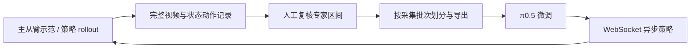

# SO101 × OpenPI：采集、人在环数据迭代与 π0.5 推理优化

基于 [Physical Intelligence OpenPI](https://github.com/Physical-Intelligence/openpi) 的 SO101 扩展。围绕桌面积木抓取，将主从臂示范采集、策略异步推理、人工纠正区间复核、数据导出和 π0.5 微调串成可检查的工程流程，并在 NVIDIA L40S 上评估 FlashRT 混合精度推理。

**阅读入口：** [具体贡献与证据](docs/so101/evidence-map.md) · [运行命令](docs/so101/commands.md) · [性能实验](docs/so101/performance.md) · [本次离线验证](docs/so101/validation.md)

## 主要工作

- **统一数据契约：** 两路完整 RGB 图像、六维实测状态和六维绝对目标。机械臂五关节使用 LeRobot 标定位置范围 `[-100,100]`，夹爪 `[0,100]`，不是弧度或关节增量。见 [contract.py](src/openpi/so101/contract.py)。
- **人在环采集：** 保存人工/策略来源、暂停边界、动作与时间信息；两次空格分别暂停和进入人工接管。复核后的人工区间才能导出，动作块不跨策略段、暂停或缺帧边界。见 [collector.py](src/openpi/so101/collector.py)、[export.py](src/openpi/so101/export.py)。
- **异步推理：** WebSocket 请求与控制解耦；过期响应、接管前的旧动作块被丢弃；推理传输可缩放图像，原始录制仍保留完整图像。见 [runtime.py](src/openpi/so101/runtime.py)。当前实现是异步动作块管理，未将其标为已验证的 RTC 方法实现。
- **训练适配：** 本地 LeRobot v3 数据加载、六维有效动作损失、归一化绑定及冻结 VLM 的动作专家训练入口。见 [train.py](scripts/so101/train.py)、[training.py](src/openpi/so101/training.py)。
- **部署性能分析：** 比较动态 INT8、JAX BF16、FlashRT BF16、VLM FP8＋动作专家 BF16，保留原始数值输出及误差分析。

这里的 DAgger 数据迭代指从策略访问状态收集人工纠正，再由人工复核并重新导出训练集；不自动将策略动作变成专家标签，不自动启动下一轮训练。

