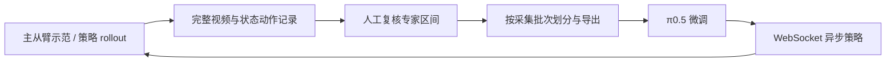
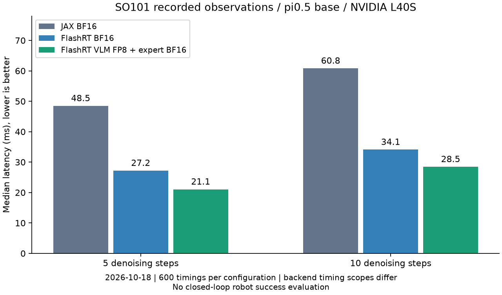

# SO101 × OpenPI：采集、人在环数据迭代与 π0.5 推理优化

基于 [Physical Intelligence OpenPI](https://github.com/Physical-Intelligence/openpi) 的 SO101 扩展。围绕桌面积木抓取，将主从臂示范采集、策略异步推理、人工纠正区间复核、数据导出和 π0.5 微调串成可检查的工程流程，并在 NVIDIA L40S 上评估 FlashRT 混合精度推理。

**阅读入口：** [具体贡献与证据](docs/so101/evidence-map.md) · [运行命令](docs/so101/commands.md) · [性能实验](docs/so101/performance.md) · [本次离线验证](docs/so101/validation.md)

## 主要工作

- **统一数据契约：** 两路完整 RGB 图像、六维实测状态和六维绝对目标。机械臂五关节使用 LeRobot 标定位置范围 `[-100,100]`，夹爪 `[0,100]`，不是弧度或关节增量。见 [contract.py](src/openpi/so101/contract.py)。
- **人在环采集：** 保存人工/策略来源、暂停边界、动作与时间信息；两次空格分别暂停和进入人工接管。复核后的人工区间才能导出，动作块不跨策略段、暂停或缺帧边界。见 [collector.py](src/openpi/so101/collector.py)、[export.py](src/openpi/so101/export.py)。
- **异步推理：** WebSocket 请求与控制解耦；过期响应、接管前的旧动作块被丢弃；推理传输可缩放图像，原始录制仍保留完整图像。见 [runtime.py](src/openpi/so101/runtime.py)。当前实现是异步动作块管理，未将其标为已验证的 RTC 方法实现。
- **训练适配：** 本地 LeRobot v3 数据加载、六维有效动作损失、归一化绑定及冻结 VLM 的动作专家训练入口。见 [train.py](scripts/so101/train.py)、[training.py](src/openpi/so101/training.py)。
- **部署性能分析：** 比较动态 INT8、JAX BF16、FlashRT BF16、VLM FP8＋动作专家 BF16，保留原始数值输出及误差分析。



这里的 DAgger 数据迭代指从策略访问状态收集人工纠正，再由人工复核并重新导出训练集；不自动将策略动作变成专家标签，不自动启动下一轮训练。

## 已有性能证据

2026-10-18，L40S，π0.5 基础权重，双路 224×224 图像、horizon 10；64 组真实校准观测和 64 组评估观测来自不重叠 episode。每配置预热 100 次，计时 3×200 次。

| 后端 | 5 步去噪中位延迟 | 10 步去噪中位延迟 |
|---|---:|---:|
| JAX BF16 | 48.48 ms | 60.82 ms |
| FlashRT BF16 | 27.21 ms | 34.11 ms |
| FlashRT VLM FP8＋动作专家 BF16 | 21.07 ms | 28.46 ms |

相对 JAX 的整体改善约 **2.30× / 2.14×**，包含运行时变化，且两者计时边界不同；同一 FlashRT 后端下的 FP8 收益约 **1.29× / 1.20×**。这些是历史离线延迟测试，不是完整机器人控制周期或量化后抓取成功率。[数据、误差与限制](docs/so101/performance.md)。



## 不接机器人也能检查

Python 3.11+，系统需有 FFmpeg。以下轻量依赖用于 SO101 数据边界与协议测试，模型相关检查需要完整 OpenPI 依赖，缺少时明确跳过。建议在独立虚拟环境中安装；完整训练另按项目依赖安装。

```bash
python -m pip install -r requirements-so101-offline.txt
export PYTHONPATH="$PWD/src:$PWD/packages/openpi-client/src:${PYTHONPATH:-}"
python -m unittest discover -s tests/so101 -v
python scripts/so101/offline_acceptance.py --output /tmp/so101-acceptance-new
python scripts/benchmarks/verify_published_results.py
```

验收输出目录必须不存在；合成夹具只验证软件，不代表训练效果。真机采集、微调、推理命令见 [操作指南](docs/so101/commands.md)。硬件采集必须显式指定 `--hardware`。

## 项目边界与归属

本仓库的 SO101 采集/数据/训练适配、异步策略及基准脚本是扩展工作；π0.5 模型来自 OpenPI，低精度内核来自外部 FlashRT。遵循仓库 [Apache-2.0](LICENSE) 及 [Gemma 条款](LICENSE_GEMMA.txt)。FlashRT 版本与调用方式见实验 provenance。

当前公开材料尚不足以复核“30 条新增样本令成功率从 80% 到 90%”、抓取顺序消融或 RTC 平滑性效果，暂不把它们列为已验证结果。实际采集数据、微调权重和 GPU 运行环境未随仓库分发；完整重跑需要自行准备。
